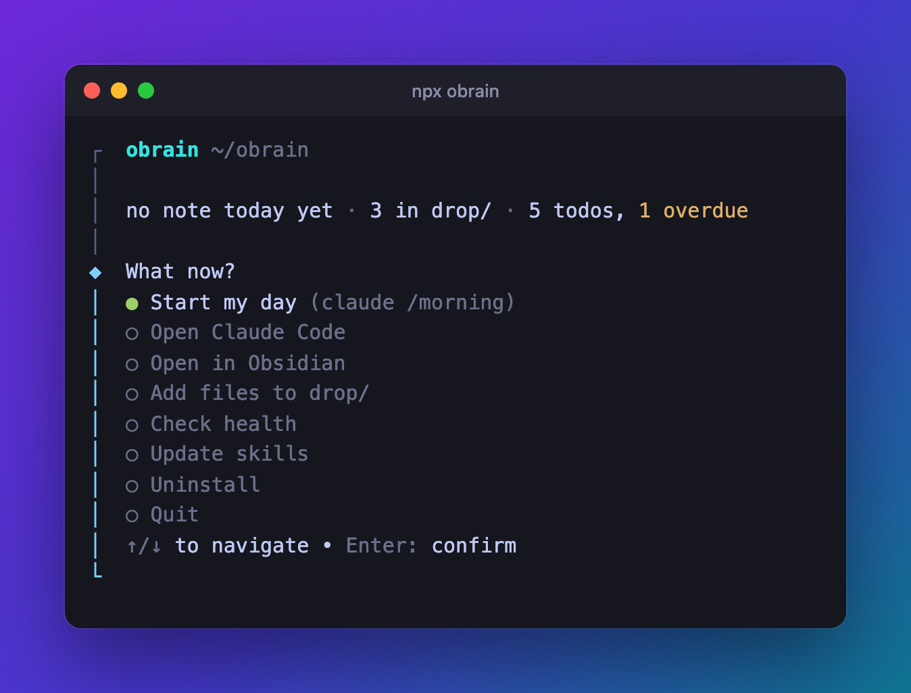
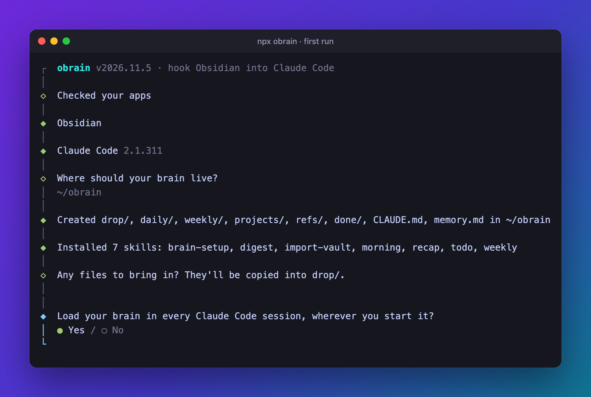
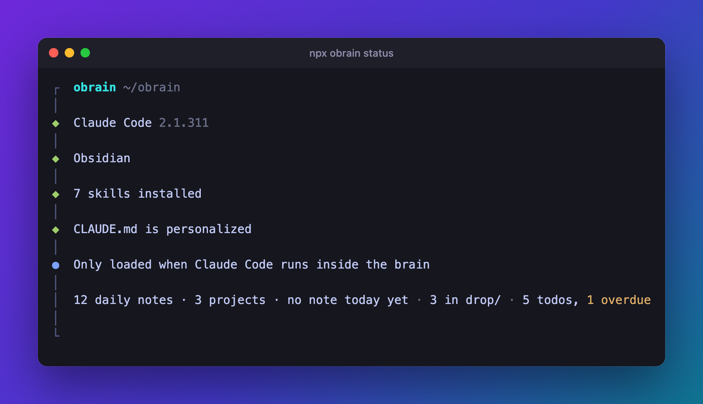

<div align="center">

# obrain

**Stop re-explaining yourself to AI every session.**

obrain wires [Obsidian](https://obsidian.md) into [Claude Code](https://claude.ai/code).
Your notes, files and projects live in one folder, and Claude reads it before you type a word.

[](https://www.npmjs.com/package/obrain)




</div>

```bash
npx obrain
```

## Why

Every new Claude Code session starts from zero. You explain your projects again, paste the same
context again, and lose whatever you figured out last time.

obrain gives Claude a memory you own: a plain Obsidian vault of markdown files on your disk. You
write daily notes and drop in files; Claude reads them at the start of each session, files new
things where they belong, and keeps a log of how you work. The more you use it, the less you
explain.

- **Local.** Markdown files in a folder. No server, no account, no API keys, nothing phones home.
- **Yours.** It's an ordinary Obsidian vault. Stop using obrain and your notes stay put.
- **Small.** One dependency, a few slash commands, and a menu for the everyday bits.

## Get started

```bash
npx obrain
```

The first run is a short wizard. It checks for Obsidian and Claude Code (and offers to install
them), asks where your brain should live, builds it, and opens it in Obsidian.

<p align="center">
  
</p>

Then open Claude Code in the brain and run **`/brain-setup`**. Claude asks two questions about
how you work and tailors the folders, the skills and `CLAUDE.md` to you.

**Already have a vault?** Point the wizard at it. It adds what's missing and leaves your notes
and your `CLAUDE.md` alone.

## Every day

Run `npx obrain` again and you get the menu above: what's waiting for you, and one keypress to
start the day. **Start my day** opens Claude Code in your brain and runs `/morning`, which
creates today's note, reads anything new in `drop/` and flags overdue todos.

Every menu item is also a command:

| Command | What it does |
| --- | --- |
| `npx obrain morning` | Open Claude Code in your brain and run `/morning` |
| `npx obrain start` | Open Claude Code in your brain |
| `npx obrain open` | Open your brain in Obsidian |
| `npx obrain drop <files...>` | Copy files or folders into `drop/` |
| `npx obrain status` | Health check: apps, skills, today's note, todos |
| `npx obrain update` | Update the skills, keeping any you've edited |
| `npx obrain uninstall` | Remove obrain, keep your notes |

Add `--yes` to skip every question (handy in scripts) and `--no-install` to never install apps.
`npm i -g obrain` drops the `npx`.

<p align="center">
  
</p>

## Inside Claude Code

| Command | What it does |
| --- | --- |
| `/brain-setup` | One-time setup. Asks about your work and builds a tailored brain. |
| `/morning` | Start of day. Opens today's note, checks what's new, asks what to focus on. |
| `/weekly` | End of week. Reviews the daily notes, finds patterns, plans next week. |
| `/recap` | End of session. Captures what happened and files it. |
| `/todo` | Task list in `todo.md`: add, finish, reprioritize. |
| `/digest` | Reads a folder of files (PDFs, docs, images) and writes markdown summaries. |
| `/import-vault` | Pulls notes from another Obsidian vault into this brain. |

You don't have to type them: Claude picks the right one when you say "start my day", "add a
todo" or "save this session".

The skills live in your brain's `.claude/skills/`, so `/brain-setup` can tailor them to your
folders. During setup you can also have Claude load your brain in every session, wherever you
start it.

## Bring in your files

PDFs, Word docs, slides, screenshots: copy them into `drop/` and Claude reads them natively.

```bash
npx obrain drop ~/Downloads/receipts ~/Desktop/whiteboard.jpg
```

Then tell Claude: *"digest and sort drop/"*.

## What's in a brain

```
~/obrain/
├── CLAUDE.md     who you are and how the brain works — loaded every session
├── memory.md     what Claude has learned about how you work
├── todo.md       one task list
├── drop/         incoming files and ideas
├── daily/        one note per day
├── weekly/       weekly reviews
├── projects/     active work, one folder each
├── refs/         reference material
└── done/         finished work; nothing gets deleted
```

`/brain-setup` adds folders that fit you: `people/` and `decisions/` if you run things,
`clients/` if you advise, `courses/` if you're learning.

## Requirements

- macOS or Linux, with Node.js 20.12 or newer
- [Obsidian](https://obsidian.md) (free) and [Claude Code](https://claude.ai/code). The wizard
  installs them if they're missing: Homebrew on macOS, Flatpak on Linux.

## Uninstall

```bash
npx obrain uninstall
```

This removes the skills, the template `CLAUDE.md`, the `## obrain` block in
`~/.claude/CLAUDE.md` and obrain's config. Your notes, `todo.md`, `memory.md` and a personalized
`CLAUDE.md` stay, and so do Obsidian and Claude Code.

## Development

```bash
git clone https://github.com/wozacosta/obrain.git && cd obrain
npm install
npm test             # node:test, no extra tooling
node bin/obrain.js   # run the CLI from the checkout
```

`./setup.sh` and `./uninstall.sh` still work for a clone; they call the same CLI.

## License

[The obrain License](LICENSE): MIT with personality.
